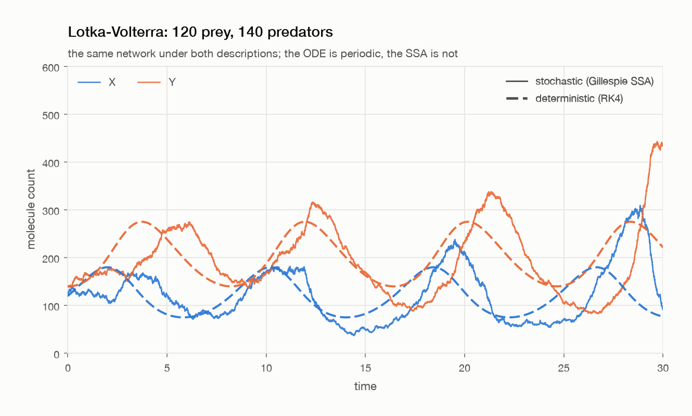
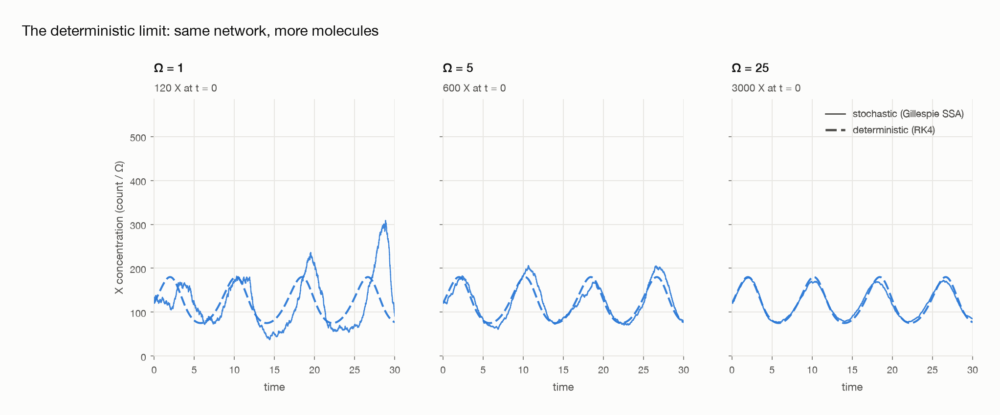
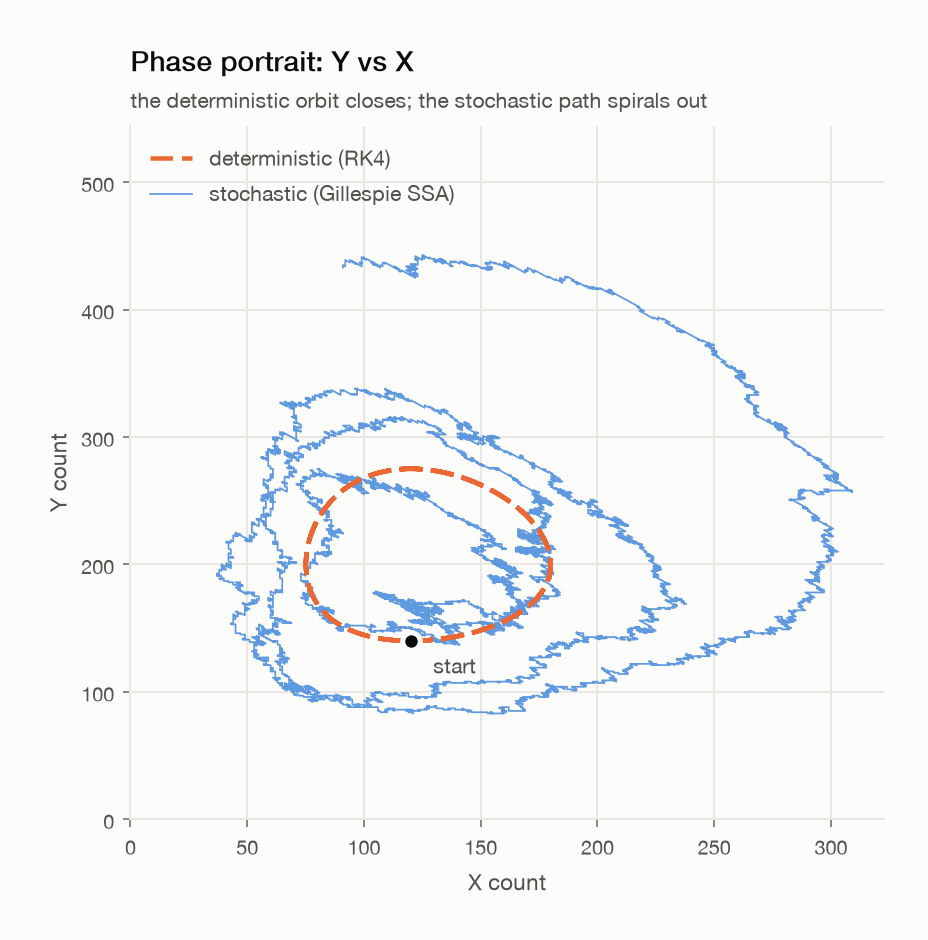
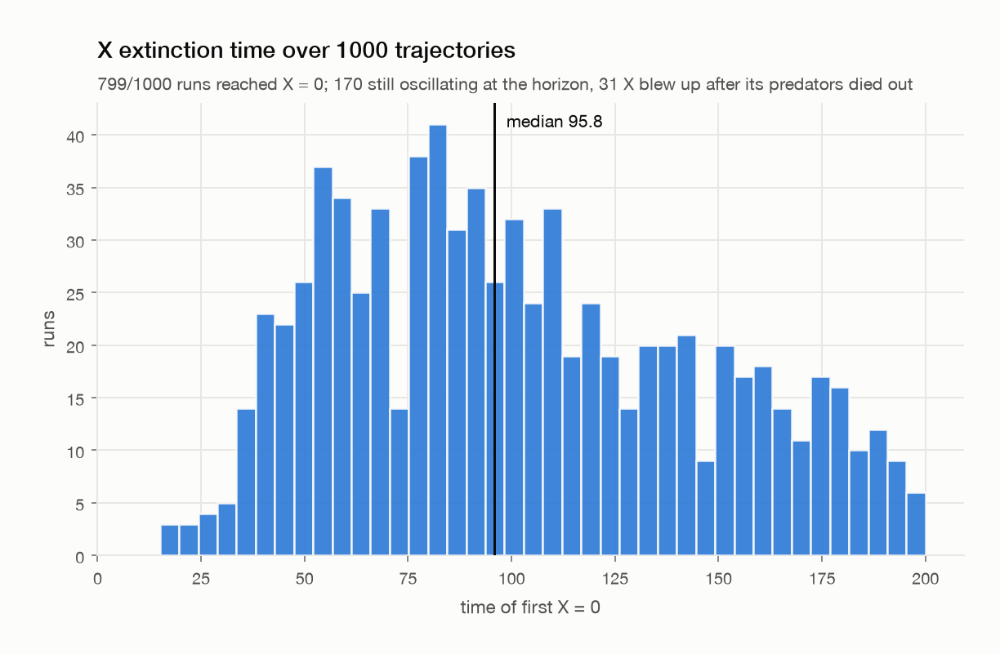
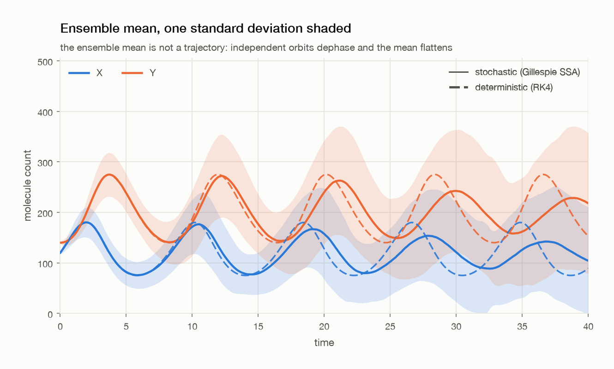
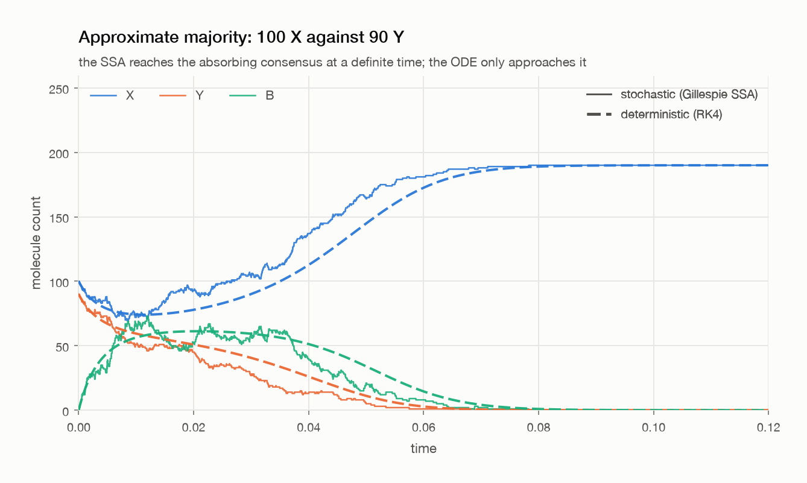
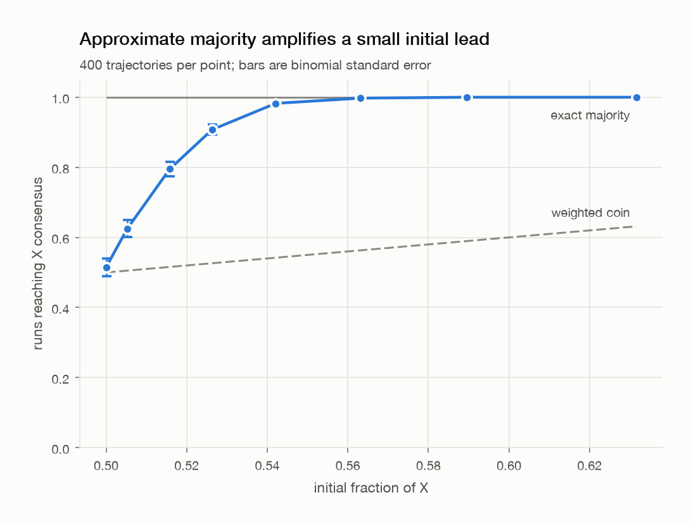
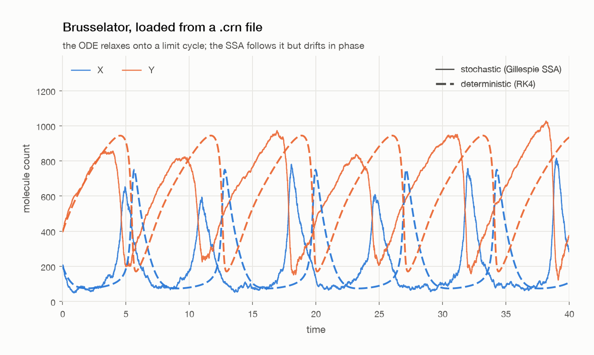

# crn-simulator

A Gillespie stochastic simulator and an RK4 integrator for the same chemical
reaction network, so the two descriptions can be compared directly.

Reaction networks are usually taught as deterministic ODEs. That description is
a large-volume limit, and it stops being a good one inside a single cell, where
you have tens or hundreds of discrete molecules and the dynamics are genuinely
noisy.



## Build and run

A C++17 compiler and `make`. Nothing else.

```
make
./crnsim --network lotka-volterra --out data/lv.csv --ode-out data/lv_ode.csv
```

For the plots:

```
make venv
.venv/bin/python python/plot.py data/lv.csv --ode data/lv_ode.csv
```

`make demo` regenerates every dataset in `data/samples/` and every figure below
from scratch; it's all seeded, so it reproduces byte for byte. `make test` runs
the test suite, `make bench` prints thread scaling, and `--help` lists the flags.

## What the comparison shows

**The ODE is a limit, and you can watch it arrive.** `--scale Ω` multiplies
every count by Ω and divides each rate constant by Ω^(order−1). The
deterministic trajectory in concentration doesn't move; the relative
fluctuations shrink as 1/√Ω.



**Stochastic Lotka–Volterra isn't periodic.** The ODE orbit closes forever. The
stochastic amplitude random-walks instead, and `X = 0` is absorbing, so the prey
eventually go extinct and the predators decay out behind them. Over 1000
trajectories to t = 200, 799 hit `X = 0`, with a median extinction time of 95.8.




Averaging the ensemble doesn't recover the ODE either. Independent orbits drift
apart in phase, so the mean flattens while every single trajectory in it is
still oscillating at full amplitude.



**Approximate majority computes.** `X + Y -> 2B`, `B + X -> 2X`, `B + Y -> 2Y`
conserves the total population and has exactly two absorbing states. From 100 X
against 90 Y — a lead of ten molecules out of 190 — 91% of runs reach X
consensus, against the 53% a coin weighted by the initial split would give.




## Networks

Built in: `lotka-volterra` and `approximate-majority`. In Lotka–Volterra, `A` is
a chemostat folded into k₁ and `B` is an untracked sink; tracking `A` as a real
count depletes it and the oscillation dies on the spot.

Anything else is a file:

```
name brusselator
tend 40
init X=200 Y=400

0      -> X   ; k = 200
2X + Y -> 3X  ; k = 5e-5
X      -> Y   ; k = 3
X      -> 0   ; k = 1
```

`0` on either side is the empty complex, which is how buffered sources and sinks
get written.



## Notes

Reactions are stored as dense multiplicity vectors over the species list, so one
expression covers every propensity: `k · Π C(n_s, m_s)`. Reaction selection is a
linear scan, which at three reactions beats anything indexed.

Two things cost me time. An absorbing state needs a guard, or the next waiting
time is `-log(u)/0`. And once Lotka–Volterra's predators die out, `X -> 2X` is a
pure Yule process: the prey grow without bound, the propensity grows with them,
and `t_end` is never reached. About 3% of runs do that, so there's a population
cap and every run records why it stopped.

Ensembles are embarrassingly parallel, and each trajectory keys its RNG on
`seed + i`, so results don't depend on the thread count — the tests check that by
diffing a 1-thread run against a 4-thread one. 1000 trajectories to t = 200 is
75.5M reaction events:

| threads | wall | events/s |
|---|---|---|
| 1 | 2.35 s | 32.2 M |
| 2 | 1.34 s | 56.5 M |
| 4 | 0.73 s | 103.2 M |
| 8 | 0.41 s | 186.3 M |

Tests check against things that are known independently — closed-form
solutions, conservation laws, exact mean waiting times — rather than against a
previous run of the simulator.

## Background

Inspired by material from ECE 381V (Unconventional Computation), UT Austin (Took the class in Spring 2026).
